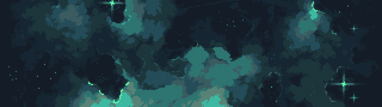

# ANALOG PLANETOID
> *A planetoid-terraforming simulator using MIDI instruments as input.*

## Doc links
- [Godot workflow](docs/godot_workflow.md) - Start here if you are unfamiliar with godot! 
- [Main scene composition](docs/scene_composition.md)
- [procedural generation](docs/procedural_generation.md) - notes & sources for procedural generation. 
- [volume rendering](docs/volume_rendering.md) - notes & sources for volume rendering.

## Directory Structure
- `docs/` is where we store documentation! put markdown files there with notes and stuff. Put any images you want to include in your docs in `docs/embeds/`.
- `assets/` will keep aaaall of the project's assets, which includes `shaders/` and `.tres` files.
- `packedscenes/` contains "prefabs". You can see that boat components are in there for instance. These scenes are meant to be used inside of other scenes, such as constructing a boat, etc..  
- `playscenes/` contains any scene that is meant to be played (differing from `packedscenes/`). 
- `docs/` is where we store documentation :) please keep everything in markdown format and be sure to link to your sources!
- Keep all scripts in `src/` folder.

## Dependencies 
- Godot 4.7.2
- MIDI plugin

## Musical terms' canonical use in this project:

### Important re. the loop:
- 4 / 4 rhythm, meaning 1 bar = 1 2 3 4 beats
- 1 planetary revolution = 4 bars
  - **1** 2 3 4 | **2** 2 3 4 | **3** 2 3 4 | **4** 2 3 4

### Musical concepts in discussion:
- **Chords**: Major and minor chords
  - C-major (C) C - E - G / I - III - V / base note + 4 steps + 3 steps
  - C-minor (Cm) C - Eb - G / I - iii - V / base note + 3 steps + 4 steps
  - [Introduction to Chords](https://www.musictheory.net/lessons/40)
- **Scales**: Major and minor scale
  - C-major (C) C - D - E - F - G - A - B / base note + 2 + 2 + 1 + 2 + 2 + 2 + 1 (base note) steps
  - C-minor (c) C - D - Eb - F - G - Ab - Bb / base note + 2 + 1 + 2 + 2 + 1 + 2 + 2 (base note) steps
  - [The Major Scale](https://www.musictheory.net/lessons/21)
  - [The Minor Scale](https://www.musictheory.net/lessons/22)

### Interchangeable terms:
- Bar = Measure
- Revolution = Loop
- Minor = moll (sv)
- Note = Pitch (MIDI event fieldname)
- Dynamics = Forte, Mezzoforte, Pianissimo, Largo etc.
  - The terms above are fancy italian words that describe how a piece (entire musical piece or a set of bars) is played
  - Velocity (MIDI event fieldname)

## Credits
give credits to: 
- VIC studio, 
- authors of papers we implement,
- authors of any plugins or tools we end up using (incl. godot)
- [Godot MIDI Player for Godot Engine 4.x by Yui Kinomoto](https://github.com/arlez80/godot-midi-player-g4)

### MIDI related controls and documentation

- [Godot documentation: InputEventMidi](https://docs.godotengine.org/en/stable/classes/class_inputeventmidi.html)
- [Plugin: Godot MIDI Player for Godot Engine 4](https://godotengine.org/asset-library/asset/1667)
- [Soundfont used in project rn: Jnsgm2.sf2](https://github.com/wrightflyer/SF2_SoundFonts/blob/master/Jnsgm2.sf2),
*sourced from [Reddit: What’s the best all-around soundfont?](https://www.reddit.com/r/midi/comments/pmh94q/whats_the_best_allaround_soundfont/)*

- [Solarsystemscope: Temporary HDRI](https://www.solarsystemscope.com/textures/)
