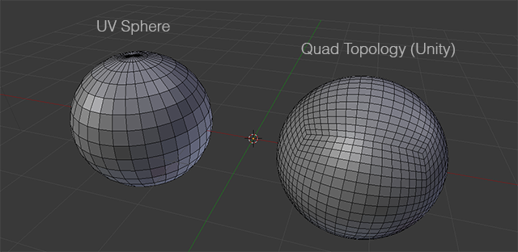
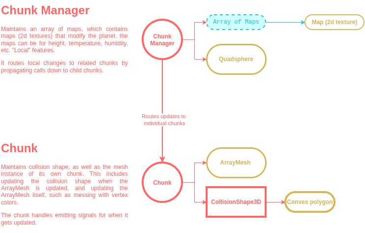

# Procedural Generation 
Here is documentation for how to work with our procedural generation systems, including how it works.
## Quadsphere

A quadsphere is useful because it suffers far less from edge-clustering at the top & bottom vertices. Size Variance of Faces is also much smaller than on a traditional UV sphere. It also lets us divide the sphere into 6 equally sized regions with ease :) Which is easy to divide into chunks!

### Chunking 
Each surface of the quadsphere can be split up into 6 separate sets of `{MeshInstance3D, CollisionShape3D}`. An advantage of chunks is that we can modify individual parts of the mesh without needing to rebuild it. 

There are two important Node classes to consider: the `Chunk` and the `ChunkManager`. 

#### ChunkManager
Contains an array of maps, which are 2d textures that define terrain features of the planet. Initially, the array of maps will only contain a map for height. 

ChunkManager is the definitive source of truth for the planet's surface. It might be valuable to make an individual array for each chunk, where we store maps for each surface. This means that we have to account for edge detection. 

#### Chunk
A chunk is the contact point for edits. It needs to have the following functionality:
1. map collision point to mesh point 
2. map mesh point to UV coordinates
3. update collision shape from mesh shape 

terrain modifications are directly made to it. 

> [!TIP]
> modify individual chunk meshes via `chunk.gd`. Modify the entire quadpshere via `chunk_manager.gd`. I recommend using the [SurfaceTool](surfacetool.md) for mesh modifications[godot docs tutorial](https://docs.godotengine.org/en/latest/tutorials/3d/procedural_geometry/surfacetool.html). 

## how do meshes work?
We can read surface arrays of anything that has a shape in Godot. Surface arrays are arrays that store info about the surface (duh). This is used for both collision shapes, as well as visual instances of meshes. 

> [!TIP]
> Access face idxs and their stored values by getting ahold of `Mesh.ARRAY_INDEX`. If you want vertices, access these by getting ahold of `Mesh.ARRAY_VERTEX`.

In [chunk.gd](../src/chunk.gd), we use a copy of the chunk's mesh as the shape for its collision shape. To ensure parity between the two, we create it using `shape.create_trimesh_shape()`. This creates an *unoptimized* collision shape where every single triangle is used for the mesh. 

In most scenarios, doing something like this is insane and a bad idea, Unity outright forbids it, enforcing a strict limit on how many faces a collision shape is allowed to have. Godot gives us more liberty in that regard. 

## Surface Tool 
The surface tool is similar to how OpenGL Immediate tool works. As someone who has never worked with OpenGL, this wasn't a particularly useful description, so here is my take on it instead: 

taken from [quadsphere.gd](../src/quadsphere.gd): The surface tool is stateful. It builds meshes based on attributes which are configured before adding vertices to a mesh.

Before beginning, we initialize the surface tool: `st := SurfaceTool.new()`. We then call `st.begin(Mesh.PRIMITIVE_TRIANGLES)` the `begin(...)` function specifies what type of mesh the surface tool is going produce. We can also use it to create simple lines too by passing `Mesh.PRIMITIVE_LINES`, which is super useful for debugging. Thereafter, we do the following to make a mesh:

1. 	Set attributes by calling various functions, e.g `st.set_color(...)`. Attributes are in a "waiting state" until the next step occurs.
2. 	call `st.add_vertex()` to append a vertex. This will load the vertex with all previously set attributes.
3. 	`st.commit(self)` creates a surface which is then appended to the ArrayMesh. Calling `st.commit(self)` again will create a a *new* surface, seperate from the previous. You can sort of see it as using Git: commiting doesn't override your previous work, unless you explicitly revert a commit. Make sure to use `st.clear()` after a commit so you don't accidentally commit already-commited geometry.
4. 	`clear_surfaces()` wipes all surfaces from the ArrayMesh, so it lets you reset it that way. You can also use `surface_remove(surface_idx: int)` to wipe a specific surface.
5. 	Surfaces can be named with `surface_set_name(idx: int, string: title)`.

## Related
- [Scene Composition for the Planet](scene_composition.md#Planet.tcsn)
