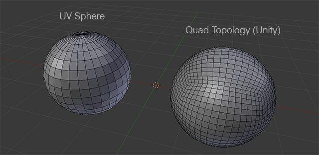

# Procedural Generation 
Here is documentation for how to work with our procedural generation systems, including how it works.
## Quadsphere

A quadsphere is useful because it suffers far less from edge-clustering at the top & bottom vertices. Size Variance of Faces is also much smaller than on a traditional UV sphere. It also lets us divide the sphere into 6 equally sized regions with ease :) Which is easy to divide into chunks!

### Chunking 
Each surface of the quadsphere can be split up into 6 separate sets of `{MeshInstance3D, CollisionShape3D}`. An advantage of chunks is that we can modify individual parts of the mesh without needing to rebuild it. 

> [!TIP]
> modify individual chunk meshes via `chunk.gd`. Modify the entire hexapshere via `chunk_manager.gd`

## Related
- [SurfaceTool](surfacetool.md)
- [Scene Composition for the Planet](scene_composition.md#Planet.tcsn)
