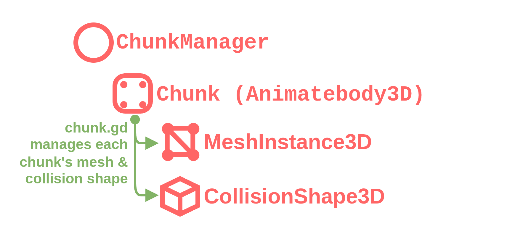

# Main scene composition

Node3D root
- Node3D planetoid 
  - Node3D terrain 
  - Node3D multimeshes 
  - Node3D Sky? 
  - I WILL FILL THIS OUT ONCE I START WORKING ON IT!!!

## Planet.tcsn
A Planet holds a ChunkManager Node, which in turn holds Chunk nodes of a [Quadsphere](procedural_generation.md##Quadsphere). Chunks are AnimatableBody3D, which is like a StaticBody, except that it can affect other physics bodies when it's updated. Each Chunk has a MeshInstance3D, and a CollisionShape3D, which define its appearance & shape. Whenever a Chunk updates its mesh, it should rebuild the CollisionShape as well.

A planet's ChunkManager can be modified to make it larger, increase its vertex count, and change the material of its individual faces. 

> [!TIP] 
> Because we are using CollisionShape3D, You can use AreaCast3D and RayCast3D to detect individual chunks with ease! It also gives you access to loads of other useful things, such as plane normals and tangents. 

